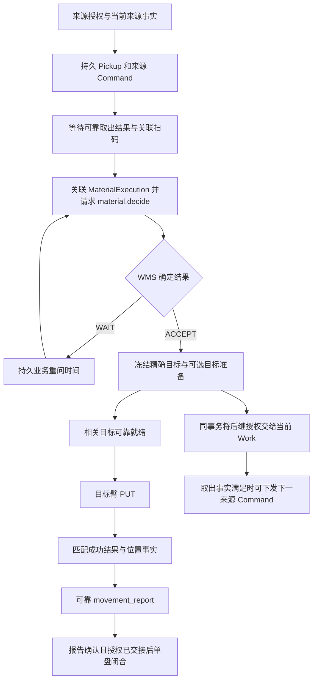

# 自动拣料插件系统设计

## 1. 设计基线与交付范围

本设计按 [SRS 第 0 章与 §3.3.3](../../architecture/SRS.md)和[出库主合同](../../contracts/wms-outbound-picking-task-integration-requirements.md)重写。
2026-09-22 原稿中的共享包抽取、人工插件搬迁、旧表结构、旧路线状态机和历史实施任务全部退出本次设计。
本文件是待评审的目标设计，不表示插件、接口升级或设备接线已实现，也不把主合同整体标为已批准。

[WMS 联合确认](../../integration/wms-joint-confirmation-automatic-picking.md)已接受来源 revision、单 Cell 工作授权、扫码原文、目标层列及下一来源对象。
本文使用这些已确认语义；不推定设备映射、字段值域和供应商附录也已确认。具体 HTTP 字段以主合同为准，本文不建立第二套 wire。

| 本次设计覆盖 | 边界 |
| --- | --- |
| 独立 `automatic-picking` 插件，支持 `AUTO`，本次目标线 `KT11` | 业务代码不得硬编码示例线号、设备码或位置码 |
| 任务准备、计划应用、来源架投料、Bin 工作、直接取料、逐盘循环、回程及完成确认 | 自动插件自行定义触发、顺序和完成条件，不能默认继承人工流程 |
| 正常 `READY / NO_WORK / WAIT`、物料 `ACCEPT`、目标 `ROTATE / REPLACE` | 首个执行切片覆盖正常链路；空取与 NG 保留长期合同，另做切片 |
| 可靠恢复、取消、迟到事实及部分接线边界 | 只使用已批准事实与接口，不新增恢复 API、通用工作流或资源锁 |

不建立 `bin-line-common` 包，不迁移或导入 `manual-picking` 的业务代码、私有表、Passage、drain 或测试。
复用 wire 和基础可靠机制不等于复用业务流程。WorkLine 沿用现有绑定、启停和清线规则，本次不实现插件切换功能。

## 2. 基础能力与业务实现分离

依赖方向如下；`deployment/` 仅负责显式装配已安装包：

```text
automatic-picking 纯 Decision ──→ wes_plugin_sdk
automatic-picking 应用层      ──→ src 中基础应用端口、SDK
deployment/                  ──→ 宿主基础能力 + 已安装插件
src / wes_plugin_sdk         ──×→ automatic-picking / manual-picking
```

| 所有者 | 唯一责任 | 本设计的使用方式 |
| --- | --- | --- |
| WMS | 任务、库存、当前来源需求、精确目标、业务终态 | 插件消费已批准的 typed operation，不自行分配或替换来源/目标 |
| 宿主 PickingTask / plan_delta | 发布接收、连续版本、成员身份、取消 Evidence、通用激活入口 | 注入插件 prepare、plan admission、plan applied、batch 与 completion 能力 |
| Transport | 冻结搬运、原身份提交、接纳、终态、位置事实及发布 | 插件决定为什么、何时搬运，基础层不解释自动拣料步骤 |
| DeviceCommand / 统一设备入口 | 命令身份、冻结合同、单次收发、结果留存与可靠处理 | 插件提供获批逻辑参数，ECS 原子裁决接纳与物理互斥 |
| InboundEvidence / FactProcessor | 可靠接收、领取租约、延期重领、发布和重放 | 插件解释 typed 业务事实并返回决定，不复制 inbox、重试或 outbox |
| WmsConfirmation / WmsClient / Adapter | 同事务保存可靠义务、单次有界 I/O、原身份重提、响应留证 | 插件经唯一 `wms_operations` 固定方法构造不可变 intent |
| MaterialExecution / PositionProjection | 单盘通用执行身份、已确认位置与因果更新 | 不添加 AUTO 业务状态机、Cell 排序或扫码台容量管理 |
| 自动插件 | 执行轮次、当前来源授权、Cell 循环、目标准备、业务顺序与完成判断 | 纯 Decision 不做 I/O，应用层协调数据库事务及基础端口 |
| ECS/PLC/RCS | 设备动作、硬件锁、扫码台单盘交接、车辆与物理资源裁决 | 插件不实现坐标、速度、设备级占槽、跨臂软件互锁或预测容量 |

插件纯层只接收不可变 typed snapshot/outcome，不解析 JSON、不按 operation 字符串分发。
宿主在静态 operation 边界构造 typed outcome；插件应用层使用具名 reader 关联冻结业务上下文。
插件业务状态和相应 Action/Obligation 在同一事务提交，外部 I/O 与队列唤醒均在提交后发生。
读取活动记录和写入业务记录遵守应用协调 → 所属 Repository → Database；应用层只经 Service 创建基础执行对象，不绕过其身份、校验和可靠机制。

## 3. 当前代码与目标差异

2026-10-16 基于 `develop` 的 `d38cced4` 核对，以下为实现差异，不是目标语义的替代来源：

| 能力 | 当前证据 | 后续工作 |
| --- | --- | --- |
| 插件与静态装配 | `workline_plugins/`、`deployment/plugin_definitions.py` 当前只有人工插件 | 新建独立包、声明与显式装配，不放成功占位 handler |
| 插件恢复入口 | 已有 `InstalledWorkLinePlugin`、`PluginRuntimeBinding`、FactProcessor、batch/completion driver 注入 | 复用入口，自动业务推进和持久查询由自动插件实现 |
| 首批计划缺失时的确认 | 当前 completion driver 在 EXECUTING 且 revision ≥ 1 的分支调用，尚无本设计要求的插件等待进度和首批期限配置入口 | 自动插件在前置 `advance_completed_in_session` 钩子委托同一完成协调器扫描 PREPARING；业务参数与判断归插件 |
| `work_plan` | wire 与 SDK 仍为 `cell_ids[]` | 一次性替换为已确认的单 Cell 与物理参数，同步 typed converter、OpenAPI、fixture 和消费者 |
| 逐盘决定 | 仍为 `six_in_one`、枚举型 `next_source_action` 和旧目标 locator | 同步 `barcode`、目标 `rack_layer/rack_column`、可省略的下一来源对象 |
| `RACK_SLOT` 物料链 | decide、empty、movement 的当前 DTO 尚缺 `plan_revision` | 请求、SDK、转换和校验一次性对齐成员身份，不影响 `BIN_CELL` 的本地轮次关联 |
| 整架完成 | 已有 `return_rack_task_completion` wire、OpenAPI、持久接收和人工消费 | 复用基础接收，新增自动插件的范围应用，不能导入人工消费者 |
| MaterialExecution 物料 Fact 路径 | 当前 FactBuilder/DecisionApplier 有入库专属 outcome 与 intent 接线 | 补齐固定出库 typed 接口，不把 AUTO 业务分支、裸 JSON 或兼容 fallback 放进通用内核 |
| 机械臂附录 | 仍为 `Draft`，含未决身份、参数映射和结果语义 | 未确认字段不猜测、不接生产设备，可先做不依赖这些值的纯 Decision 与基础接线 |
| 报告所需 PkgID | 已确认 decide 请求仅传 barcode，目标响应未声明 PkgID；movement_report 仍必填 PkgID | 权威来源须联合补齐，不能恢复旧 six_in_one 或自行拆条码填充 |

源码导航：[插件装配端口](../../../src/app/workline/installed_plugin.py)、[FactProcessor](../../../src/app/execution/services/fact_processor.py)、
[周期激活入口](../../../src/app/wms_integration/outbound_picking/services/picking_task_plan_activation.py)、
[typed facade](../../../src/wes_plugin_sdk/src/wes_plugin_sdk/wms_operations.py)。
这些入口存在不代表出库物料端到端路径已可用，接入验收必须覆盖真实调用及恢复。

## 4. 身份与最小持久化

### 4.1 身份不混用

| 身份 | 作用与约束 |
| --- | --- |
| 来源成员 | 五层架：`task_id + plan_revision + rack_id + rack_face`；直接取料增加精确 `source_locator` |
| Bin 工作轮次（本文称 Work） | 本箱本次经过的本地 ID，关联当前冻结批次成员和 SCAN2 Evidence；同任务同箱可多次经过 |
| 单次取盘（本文称 Pickup） | 扫码前即存在的本地身份，关联本次 Work 或 DirectPick 成员、来源授权与来源 Command |
| 单盘执行 | 关联到 Pickup 的 `MaterialExecution`；`PkgID` 由 WMS 从扫码原文判断，WES 不解析或编造 |
| Action | 本次 execution + 逻辑动作角色 + 触发 Evidence；技术重试复用原身份及正文 |
| WMS 消息 | `(operation, operation_id)`；新业务决定使用新身份，不能改写原请求 |

同一物理货架在同一进场生命周期中可被不同 revision 成员复用，成员业务身份仍各自独立。
`last_applied_plan_revision` 仅为连续接收游标，不能证明旧成员完成或新成员失效。
取消以原成员取消 Evidence 为准，父任务状态、旧面级结果和旧整架完成均不能代替新成员的事实。
业务记录绑定本次 WorkLine 及冻结的插件 key/version、配置与激活关联，优先引用已有不可变绑定，不复制配置主档。
迟到 Evidence 通过原绑定关联业务，不按当前默认插件或最新任务重新解释。

### 4.2 只保存恢复必需的业务关联

以下是自动插件私有持久记录的职责与必要字段，不新增宿主通用 Task/Step 引擎，也不要求每个流程阶段单独建表。
具体 DDL 随实施切片审查，外部未决值域不在本文件擅自冻结。

| 记录 | 为什么需要、最小内容 | 现有能力是否足够 |
| --- | --- | --- |
| Bin Work | 保存本轮 ID、冻结批次/成员及 Transport 关联、首次 SCAN2、work_plan 请求/最终结果引用、当前来源授权及其消费关联、明确的无后继决定、未决业务与点2交接 | Evidence 保存内容但不表达当前轮次，不能用人工 Passage 或 `(task_id, bin_code)` 历史终态代替；后继授权的当前 owner 是 Work |
| Pickup | 保存 Work 或 DirectPick 二选一关联、授权 Evidence、来源 locator、来源 Command、扫码 Evidence、MaterialExecution、目标准备/PUT/报告引用 | Command 和 MaterialExecution 已有可靠生命周期，但不能独自恢复“扫码前哪次授权取了哪盘” |
| 自动回程 execution | 保存首次 SCAN3/SCAN4 Evidence、物理 FIFO 顺序、方向命令、冻结回架决定与 Transport 关联 | 自动插件拥有回程业务，不读取人工 `BinLineReturn`；消息和运输内容仍由基础对象保存 |
| 任务确认进度 | 按现有 PickingTask 身份关联 prepare 接受 Evidence、冻结首批期限/到期时间、当前 completion_confirm 引用及业务重问时间 | PickingTask 本身没有这些等待字段；附属进度由插件拥有，不新增任务身份、公共任务状态或通用定时实体 |
| 排空进度 | 按现有 WorkLine 身份保存当前 drain operation/决定引用、WAIT 到期时间、剩余责任及本次请求成员范围和回库进度；9H 补架保留首次 READY 的 reservation operation 标量引用 | WAIT 后原 Confirmation 已结束，READY reservation 又须跨任务恢复；在途责任不等于本次可请求数量，不能用最近历史响应或其他插件表代替当前进度 |

批次完整清单、设备正文和 WMS 请求/响应只保存在已有 Evidence、Command、Confirmation 中，业务记录保存稳定引用和必要运行索引。
投箱分段和来源架阶段以原成员、冻结清单及 Transport binding 恢复；确需游标时仅保存当前未闭合进度，不复制整份计划或建立容量账。
Cell 当前栈顶归当前 Work/Pickup，待消费的后继授权只归 Work；不先建持久 Cell 库存、全线 FIFO 或统计表。
任务确认和排空进度仅补所属当前业务的期限、可靠对象引用及必要成员关联，实施时按这些职责落字段，不为每个等待阶段另建表。
首批期限从自动插件准备策略的唯一配置入口读取，在首次关联匹配的 PREPARE_ACCEPTED 时与到期时间同事务冻结，后续配置变化只影响新的等待。
该入口待实施接入，期限值及合法范围按双方配置确认，本文不猜默认值；不复用 WmsConfirmation 的技术派发 deadline，也不在 WorkLine 绑定配置中另存一套值。
一期不为“将来复用”增加配置模式、可选 owner、动态 registry 或共享业务模型。

同一有效 SCAN2 Evidence 不创建两个 Work，同一 Work 未闭合时重扫只关联既有轮次。
同一来源授权 Evidence 的同一逻辑取盘动作只创建一个 Pickup/Command，一次 `next_source_action` 不得被重复消费。
不能以 `(work_id, cell_id)` 唯一约束所有 Pickup：同 Cell 可以连续取多盘，必须按各次授权与 Action 区分。

### 4.3 扫码前后的关联

1. 取盘前，在一个事务内保存 Pickup、来源授权、原 Command 身份和冻结参数。来源 Command 可使用既有 WorkLine 业务关联，不要求先有条码或 MaterialExecution。
2. 扫码入口先可靠留存 Evidence，插件用获批关联字段精确匹配 Pickup；先到的扫码、结果或 ACK 均留存，缺少因果前提时延期应用。
3. 以唯一扫码 Evidence 通过现有 MaterialExecution 服务创建/复用单盘身份，并与 Pickup 绑定；来源 Command 保持原冻结身份，不追改其历史请求。
4. 后续决定、PUT 和结果报告关联该 MaterialExecution。一个工作计划 Evidence 可授权多次取盘，不能拿它作为多条单盘执行共用的唯一 admission Evidence。

关联优先依赖附录确认的来源 Command 引用；O1/O2 未闭合前，不用平台单盘容量、当前设备或“最近命令”推断关联。
附录 O6 的 `business_key` 不能据旧稿强制为取盘前尚不存在的 MaterialExecution ID，其必要性、回显与关联规则须随附录确认。
本地 execution/trace 身份与 PkgID 分离，不能因条码稍后识别而换执行身份。movement_report 的 PkgID 来源尚未闭合，
实施前须确认已有权威字段或修订所属外部合同；本设计不新增响应字段、不定义条码解析器，也不允许先做不可逆动作再补猜报告身份。

## 5. 自动线状态流

本节状态名表示插件负责的业务阶段，供持久查询与转移使用，不是新增公共枚举或宿主状态。
每次转移都须读取当前 Requirement、直接依赖的权威事实和已冻结 Action，不能只按上一步状态机械推进。

### 5.1 任务、来源架和投箱

| 当前阶段 | 进入依据 | 下一步与权威退出条件 |
| --- | --- | --- |
| 排队 / 准备 | issued 指定当前 WorkLine，现有准入通过 | 宿主可靠 prepare；`PREPARE_ACCEPTED` 后等待连续 plan_delta，不虚构资源 |
| 已接受准备、等待首批计划 | 当前任务仍为 PREPARING、revision=0，已有匹配 PREPARE_ACCEPTED Evidence | 保存首批到期时间；计划先到则退出此等待，到期仍无计划且满足本地完成条件则创建 revision 0 的 completion_confirm |
| 计划可执行 | plan_delta 已可靠应用，AUTO revision 1 有初始 target_rack | 插件为有效来源形成入场需求，基础层复用当前进场 Transport 生命周期 |
| 来源面到位 | 匹配当前进场/旋转身份的成功结果、位置与面向一致 | 对每个来源成员持久化一次逻辑 `inbound_batch` 义务 |
| 投料决定 | `READY` 完整有序清单，或最终空清单 `RACK_FACE_DONE` | 冻结清单按最多 4 箱分段，`RACK_FACE_DONE` 不再轮询 |
| 分段执行 | 当前分段已冻结，CTU 没有冲突的本线批次 | 下一分段须等前段权威成功、结果已发布及所有箱 SCAN1 匹配，不靠提交顺序推断清空 |
| 来源服务结束 | 全部冻结分段权威成功、已发布并到达绑定 HANDOFF_POSITION，或最终空清单 | 按 SRS 的 feed_complete 推进换面/离场，不等待该批全部拣料或回架完成 |

同一 CTU 的投箱与退箱批次串行，该业务串行不扩展为其他货架、机械臂或独立任务的全线物理围栏。
投料分段间隙最多一次机会式回架，运动前按实际到位架/面求值一次；新候选不能使已冻结的离场阶段反复回到回架求值。
`NO_BATCH` 结束该轮决定并释放未分配候选尾部，已分配、未知或未发布的直接义务仍须闭合。
不同架的后继步骤以该架自己的权威到位事实判断，不等待旧架独立离场 Transport 的最终回调。

首批到期时间以本次 prepare 接受 Evidence 的持久接收时间和已冻结期限计算，重复扫描或重启不重置。
自动插件 batch driver 的 `advance_completed_in_session` 在宿主查找 EXECUTING 任务之前被调用，由它委托插件完成协调器扫描本线 PREPARING 任务及任务确认进度；
普通 EXECUTING 分支也委托同一协调器，按任务锁和当前请求引用防重。该入口属于现有通用钩子的插件实现，不新增 AUTO 专用宿主分支或定时框架。
首批到期求值、确认创建和进度更新同事务提交；请求未定时沿原身份恢复，确定 BUSINESS_IN_PROGRESS 后保存下一重问时间，仍以当前 revision 求值。
PLAN_REVISION_STALE 等待 WMS 补发计划；计划到达后停止创建新的 revision 0 请求，已建义务继续按原身份接收结果。
旧 revision 0 响应不能关闭已应用更高 revision 的任务，须按冻结请求、当前计划和既有结果合同重新核对，不伪造计划或绕过版本冲突。

### 5.2 Bin Work 与 Cell 循环

| 当前阶段 | 事件 / 结果 | 状态转移与边界 |
| --- | --- | --- |
| 待工作位到位 | SCAN2 实际箱码 | 先记到位，再校验当前有效批次；允许缺 SCAN1、乱序到达，不能借别箱 Passage 准入 |
| 工作计划待决 | 已持久 work_plan 义务 | 结果未知沿原身份重提，不创建并行重问 |
| 工作计划等待 | 确定 `WAIT` | 保存重问到期时间；当前事实变化或到期后，对同次 SCAN2 以新 operation_id 重问 |
| 来源可执行 | `READY` 单 Cell 与物理参数 | 冻结本次授权，创建栈顶 Pickup；`cell_id` 是业务编码，设备定位用独立 `cell_index` 的获批映射 |
| 正常流出 | `NO_WORK`，或已持久保存无后继决定、没有待消费授权且本轮逐盘义务均已闭合 | 完成 Work 业务，保存点2放行 Action；空授权引用本身不证明无后继，物理流出和后续回程独立闭合 |
| 可识别但非预期 Bin | 当前批次不匹配 | 保存预期/实际身份与到位 Evidence，不请求 work_plan、不关闭预期成员、不送 NG 或自动退箱 |

当前 `BIN_CELL` 是 LIFO 物理栈，下一盘成为可执行栈顶须同时具备当前栈顶可靠取出事实和 WMS 后继来源授权。
当前栈顶结果或位置未知时保留该 Cell 因果依赖，不通过新 revision、任务或 Command 身份越过它。
后继对象可以是同 Cell 或另一 Cell，跨 Cell 不凭数字编号重排，只消费 WMS 本次后继决定。
来源成员取消不改写本箱已入线事实，已满足主合同 SCAN2 准入条件的原批次箱仍由 WMS work_plan 判断当前需求。

### 5.3 单盘 Pickup / MaterialExecution



图中的下一来源分支可与当前盘目标准备、PUT 或报告并行，它不是当前盘闭合之后才运行的串行步骤，约束见第 6 节。
Work 授权分支仅适用于 BIN_CELL；RACK_SLOT 没有该分支，不为直接取料创建 Work 或等待不存在的授权交接。
目标已经可靠就绪时无需额外 Transport；需要准备时必须等待相应 Transport 的权威事实。

| 阶段 | 唯一业务职责 | 继续条件 |
| --- | --- | --- |
| 取盘待结果 / 待扫码 | 保留来源 Command、来源授权和 Pickup | 可靠取出结果、扫码关联与来源身份一致；扫码先到可先留存，不能当作完整成功回调 |
| 物料决定待决 / WAIT | 冻结来源与 barcode 原文，RACK_SLOT 带成员 revision | 技术未知复用原身份，确定 WAIT 后才以新身份重问 |
| 等待目标就绪 | ACCEPT 已冻结目标，必要时 ROTATE 或 REPLACE | 目标架、面、工作位与相关成功 Transport 一致，不重新请求物料资格 |
| PUT 待结果 | 仅按本盘 ACCEPT 的精确目标创建 Command | 匹配该 Command 的成功 CALLBACK 与确定目标位置；ACK、超时及父任务状态均无效 |
| 位置报告待确认 | 可靠保存真实位置并创建 movement_report 义务 | `RECORDED / DUPLICATE` 后闭合本盘及依赖报告的完成条件；BIN_CELL 还须完成下文的授权/无后继交接，不等待后继 Command 创建或终态；RACK_SLOT 无 Work 交接条件 |
| 已闭合 | 单盘动作和必要交付均已完成 | 保留审计，不得授权新取盘或充当未来 Cell 当前栈顶 |

`ROTATE` 仅在同架目标面变化时执行。`REPLACE` 固定为旧架 departure 决定 → 旧架离场 → 新架进场 → PUT，
相关直接依赖须取得其合同规定的权威事实，不能把旧架接纳 ACK 当成目标工作位已物理清空。
新目标架来源只用当前权威位置；位置未知时保留原义务，不猜库位或自动改址。

**下一来源授权的原子交接：**消费 BIN_CELL 的最终 ACCEPT 时，插件锁定当前 Work 与本盘 Pickup，在保存本盘目标及后继阶段的同一事务中，
将 next_source_action 的稳定授权身份和原决定 Evidence 引用登记为 Work 的待消费授权；字段省略则保存明确的无后继决定引用。
这是当前授权的归属转交，不复制整份响应、不另建授权表；初始 work_plan READY 也以当前 Work 作为授权 owner。
原响应 Evidence 因仍被当前授权引用而属于必要运行事实，在引用退出前不可清理；恢复直接从 Work 及其当前 Evidence 取值，不查已闭合 M1 的 Pickup 或 MaterialExecution。

消费该授权时，在同一事务内核对当前 Work、授权身份、直接 Requirement 和栈顶取出事实，创建或复用 M2 Pickup/来源 Command，并把该授权标为已消费且关联 M2。
重复扫描、并发消费者和原 Evidence 重放只返回同一消费结果，不能重复创建 M2，也不能把更新的 Work 授权覆盖成旧 M1 授权。
任一事务提交前崩溃都整体回滚；提交后由 Work 上的待消费授权或既有 M2 引用恢复，队列通知丢失不丢授权。
M1 单盘闭合仅要求本盘物理动作、报告和上述交接均已完成，不要求 M2 已创建；未消费授权继续由 Work 的业务 driver 拥有。
已闭合 M1 不再授权动作。Work 只有在明确无后继、无待消费授权且本轮逐盘义务已闭合时才满足正常业务流出条件；取消等分支按其权威依据分别处理。

直接取料由当前有效 DirectPick 成员及本轮货架到位事实授权，不走 Bin work_plan，不建立虚构 Bin Work。
每个 RACK_SLOT 对应单盘来源，响应不含 next_source_action；其他直接取料由各自当前成员继续授权。
退料直接取料在竞争同一来源臂的可执行工作中优先，不抢占已创建的取盘动作，也不暂停没有直接冲突的 CTU、Bin 到位留证或目标臂工作。
退料架权威到位后可靠创建 arrival_report 义务，原报告 ACK 不作为直接取料完成后的换面/离场统一前提，报告交付仍独立闭合。
面级 direct_pick_completed 沿现有固定 operation 接收，按 task、revision、rack/face 应用，不将人工插件的结果解释搬入自动插件。
整架完成事实只覆盖同任务同架 `plan_revision <= through_plan_revision`，先等连续计划已应用，不补造逐面结果；后续成员独立判断。

### 5.4 回程、清场和任务完成

自动插件自行实现 SCAN3→SCAN4→OUTLET 回程，独立定义并验证本线拓扑，不复用人工表或仅修改其插件名前缀。
正常 Bin 在首次有效 SCAN3 到位时交接前段 Work 与回程 execution；SCAN4 首次权威到位冻结本回程通道的 FIFO 顺序。
排序使用获批设备事件时间及其稳定性合同，不用 HTTP 接收顺序、Command 提交顺序或条码排序，重扫不重排首次顺序。

| 物理队列 | 作用域与冻结顺序 | 阻塞及退出事实 |
| --- | --- | --- |
| WORK_BUFFER | 本线单向物理通道，实际箱到位与直接物理前驱依赖 | 不把 SCAN1 历史队首设为 SCAN2 准入门槛；相关运动未知不允许假定已清空 |
| BIN_CELL | 本次 Work 的当前获批 Cell，按物理栈顶 LIFO | 当前栈顶取出未知阻塞该 Cell，取出事实及 WMS 后继授权才允许下一盘 |
| RETURN_BUFFER | 本 WorkLine 实际回程通道，跨任务 FIFO，首次 SCAN4 到位冻结 | 不越过未闭合物理队头；回架候选仅为已具资格的 READY，按其首次到位顺序选择连续前缀 |

SCAN4 匹配放行 Command 的成功结果使候选具备 return_batch 资格；历史 MOVE_PENDING 不构成其他已有确定到位结果的独立 READY 的依赖。
若存在实际共同通道的未闭合物理队头则不得越序，不能借改变候选状态跳过它；UNKNOWN、失败或人工处理不自动授予越序许可。
每次 return_batch 最多取 4 个候选，WMS 只能选择连续前缀，并在当前实际到位架面分配目标，不要求原架、原面。
原 BIN_MOVE 明确 ACCEPTED 可完成 Return 的执行权交接，不能证明箱已离开 OUTLET 或已放回。
同一 WorkLine、同一 rack/face 下一轮分配须等前轮可能已接纳 BIN_MOVE 权威终态已发布且最终位置已知，其他面可继续。

换面/离场前，先核对本轮到位、本架当前面的原请求、冻结分配及直接 Transport，再判断是否有可派发候选；候选查询为空不等于原分配义务不存在。

| 本轮回架求值状态 | 换面/离场条件 |
| --- | --- |
| 尚未发起求值且无可派发候选 | 确认没有本轮冻结义务后可结束运动前求值阶段；阶段冻结后新候选不反复重开 |
| 确定 NO_BATCH 已应用并发布 | 结果匹配本轮到位、当前面和请求范围，且本轮其他直接义务均闭合后可继续；未分配候选保留 |
| READY 已确定分配 | 先沿原决定创建/恢复 BIN_MOVE；直接依赖当前架面的搬运须权威终态已发布、最终位置已知并完成相应业务收口，不能仅凭 ACCEPTED 离场；READY 尚未应用或尚未创建搬运不能离场 |
| 请求/响应未知、RECONCILING、结果未应用或未发布 | 保留原请求身份、冻结面和本轮直接依赖，不得按“无分配”推进；其他独立架及任务不受此项统一阻断 |

所有工作架耗尽后的 drain 只使用已确认 operation 与当前候选，独立于已结束的 PickingTask，不重开任务；当前轮次由插件排空进度明确关联，不查“最近一次 drain”。
创建 drain 义务时同事务记录其 operation 引用和请求范围内的回程成员身份/顺序；请求正文和完整响应仍只由 Confirmation/Evidence 保存。

| drain 阶段 | 持久状态出口与下一处理 owner |
| --- | --- |
| 请求待定 | 排空进度引用原请求，由 WmsConfirmation 负责原身份派发/重提；插件不创建第二个并行决定 |
| 确定 WAIT | 原决定闭合；自动插件 batch driver 同事务保存 WAIT Evidence 引用及接收时间加 retry_after_ms 得到的到期时间，不延长原请求或复用其身份重问 |
| 初始 WAIT 到期 | batch driver 在 WorkLine 事务锁内核对原 WAIT、当前请求引用、drain 准入和当前可回料数量；有需求且无未决请求/活动 reservation 时，以新 operation_id 创建一次新义务并替换当前进度引用；下一任务优先只作用于该初始准入 |
| READY 执行中 | batch driver 从当前引用恢复 reservation 和原冻结成员，按实际到位架面推进普通 return_batch；新入队成员不追加到旧范围，也不重复请求容量 |
| READY 耗尽但仍有原成员未回库 / 补架 WAIT 到期 | 9H 按下述原子接续，将未回库原成员交给新的当前决定；保留同一 WMS reservation 引用，不把旧进度退出当成正常完成，不因新任务到达丢弃原需求 |
| 当前等待结束 / 本轮完成 | 初始 WAIT 到期已无候选或已不满足初始准入时结束等待，保留候选供正常服务；补架 WAIT 仅在本次决定已发布且原成员全部权威回库时结束。READY 按主合同的原成员回库事实及直接义务收口，不凭超时、父任务完成或新任务到达释放 reservation |

每次初始 WAIT 后的下一请求都重新冻结当前数量及成员；原 WAIT 没有分配，不持续占有旧候选。补架 WAIT 仅在原剩余成员中重新求值，不纳入新到成员。
到期重问所需引用和时间保存在 WorkLine 所属的插件排空进度中，原任务即使已完成也可扫描；同事务替换引用保证并发扫描只生成一个新请求。
当前等待结束后，新需求从当前事实重新准入，不依赖已闭合等待历史；READY reservation 不因新任务到达被取消或覆盖，WMS 按自身权威事实管理容量释放。
本次不实现停用/插件切换触发的 drain，该触发按现有待决边界保持未实现，不由本设计自动解锁。

**9H 正常补架接续设计（文档基线，未实现；外部接续语义须按主合同 §9.2.3 的 9H 补充完成双方冻结后才启用真实请求）。**

采用“复用现有排空记录、逐请求原子交接”，不在同一记录里另维护完整供架历史或增加通用轮次表。已有 `operation_id` 始终标识该记录的冻结请求；`return_ids` 承担全部未回库责任，本次真正请求供架的成员另作冻结范围，两者在补架中可不同。新记录承接全部剩余 execution，先前已回库成员不再成为新记录的运行依赖。

- 身份只增加排空记录上的可空标量 `reservation_operation_id`：初始尚无 READY 时为空，首次 READY 应用时冻结为该请求 operation；补架新记录继承该值，后续补架 READY 仍属于它。它是外部容量义务引用，不是外键式历史依赖、库存/容量账或新授权对象；正文和完整供架集合只读当前 Confirmation/Evidence。
- 同一标量也是主合同 9H 提议的补架请求及原成员 `return_batch` 的 `data.reservation_operation_id`，不额外建立另一套 WMS/WES 对照身份。初次 drain 请求省略、补架必填且不得为 null；回架任一入口只要消费原成员就必填，不消费原成员则省略，单次不得混 owner。WMS 在决定事务内校验精确原 reservation，已结束/别线/另一轮时按原冲突合同拒绝，不按当前工作线隐式重绑。两类现有严格 wire/typed intent 尚无该字段；双方冻结后才同步各自所属 DTO、SDK、Adapter/OpenAPI、自动/人工消费者与测试，本轮只写文档，不做裸 dict、兼容别名或版本分叉。
- 范围只增加本次冻结 `request_return_ids`：`required_slot_count == len(request_return_ids)`，它是 `return_ids` 的有序子集。`return_ids` 仍包含原独立 BIN_MOVE 中的未回库成员；请求范围只取其中当前实际缓冲位的连续合格前缀，不把已确定分配重复请求、不等待独立已交接动作的终态才能为其他成员补架。初次请求两份范围相同；字段分别证明业务责任与请求身份，不能用只有数量的 wire 正文恢复成员，亦不新增在途/历史成员副表。实际 schema/存量迁移随实施另审，只能由确定当前范围建立，不猜补架或活动 reservation。
- `response_evidence_id`、`retry_at`、`departure_handoffs` 表达当前决定及本轮供架；`returned_ids` 保存当前责任范围的确定回库事实。新记录承接旧 `return_ids - returned_ids`，并冻结本次 `request_return_ids`，归还进度和本轮离场交接从空集合开始；不扫描旧根、旧 Return 或已闭合分配恢复已满足需求。初始 WAIT 的 9A 准入保持原规则，携带 reservation 引用的补架 WAIT 由补架分支推进，不新增 mode/state 字段。
- 每轮 DrainRack 仍以当前 drain 记录和 rack 关联 Binding；新 drain 记录本身区分新供架决定，同一 rack 的新轮次不冒领旧关联。原 Motion 保留原到位/READY/Transport 引用；旧排空根退出不切断这些直接依赖，也不要求旧根永久存在。未结束的原物理义务不因补架而可清理。

补架由现有 batch 前置扫描恢复，顺序是先恢复原决定/分配/物理事实，再判定原供架耗尽。当前决定的应需供架集合与 `departure_handoffs` 的逐架原 CTU03 正事实证明耗尽；交接写入已经过冻结终面、此前面序/运动前阶段和本架直接请求/BIN_MOVE 门禁，不重新扫描可清理的中间面 Motion。未到位架、未服务面或仍应启动的供架不能当耗尽，未交接的直接义务继续原恢复；独立架原成员在途动作不扩大为耗尽门禁。同架再用仍等原动作权威成功及已知 RACK_POSITION；其他独立架不因此统一等待。晚到 FAILED/RECONCILING 不抹已成立交接；已接纳后 FAILED 的新决定/动作不在本片，原 Motion 继续留证与恢复。

同一 WorkLine 锁事务中的接续步骤：

1. 精确核对当前记录、已发布决定、同一 reservation 引用、原成员及确定回库正事实，得到完整剩余责任；再从实际待派发 FIFO 冻结可请求的连续合格前缀。原在途成员仍在责任集合但不重复计数；未知/未闭合队头不得越过，新成员不凑数。没有可请求成员时不发送零数量，存在未完责任则保留当前 owner；已发布 WAIT 且责任全满足时退出。新请求必须携带精确 reservation 引用；WMS 冲突/未知保留原义务，不改成无引用的初次请求。
2. 只在上述正常耗尽或已发布补架 WAIT 到期时创建新 operation/new Confirmation；新当前记录保存相同 reservation 引用、完整剩余责任及本次请求成员。旧记录退出 current 与新可靠义务、唯一 current 同事务提交；未完独立动作的原身份不改写，后续回库事实按精确成员与 reservation 交给新 current。旧 `archived_at` 在此只表示需求已交接，不能作为“旧成员全部成功回库”的事实；不改写旧 operation、READY 或 Transport 结果。
3. 提交前任一步失败全部回滚；提交后只凭新 current 的请求身份、两份成员范围、reservation 引用恢复。旧响应按原身份留存，不能重新激活旧根、覆盖当前请求或创建第二轮动作。已可清理旧根、旧决定和已闭合分配不作为新 current 的查询前驱；原 Motion/Allocation 的直接因果引用不改写，仍被其未闭合义务引用的数据继续保留。原回库事实先于交接时写入旧 current 并在接续时扣除，后于交接时写入新 current；同一 WorkLine 锁使两种时序均有唯一责任 owner。已扣除成员的旧结果重放不把它加回新范围，同箱码新 execution 或新 reservation 不冒领旧结果。

确定补架 WAIT 保存首次结果接收时间加 `retry_after_ms` 的固定到期点；初始 prepare 优先不取消这次原业务续行。WAIT 未分配的候选可以由普通回架入口承接；两个入口在同一 WorkLine 锁下按当前 Return 身份防重，单次 `return_batch` 不跨原成员与新成员的 owner 范围。原成员无论由哪个入口、哪个前驱决定的原 Action 回库，均校验原分配/Transport/结果及同一 reservation，再将确定物理成功与当前排空 `returned_ids` 同事务落地；不再同步维护已退出 current 的旧根进度。原动作因果引用不改写；仍被该未闭合动作直接引用的旧记录不是可清理历史。到期有正数可请求成员时以新 current 接续，无可请求成员但有在途责任则等原事实及周期扫描，已全部权威回库且本次 WAIT 已发布时结束等待；不从 Return 已归档、ACCEPTED 或记录不存在推断成功。

上述普通入口也须在创建可靠请求时原子冻结原成员资格与显式 reservation 引用，不能仅在本地标注 owner、让 WMS 按承接架猜核销。WMS 依主合同保存 READY 分配的原 `(return_batch operation_id, sequence_no)`、完整箱码/来源/目标与 reservation，BIN_MOVE 接纳前唯一匹配并冻结 Transport/member 关联；无唯一匹配则冲突，不向 RCS 启动。原权威成功及匹配终位仅核销一次，NO_BATCH/未分配尾部不占名额，无引用新成员不核销原 reservation；WMS 自己维护原容量与成功名额，WES 不复制这份账。迟到结果用冻结分配归属，禁止按最新 reservation 或相同箱码更新。此项是两 operation 的待冻结合同变化，不增 WES 第三个字段/成员模型，不扩展 Transport wire；存量分配无精确归属时不猜恢复，新业务重试不在本片。

请求未知、结果未发布或已确定分配时保留原身份和成员依赖，不用新操作覆盖，也不因父任务完成/新任务到达丢弃。当前范围随后全部回库时仍先闭合已创建的可靠义务；确定结果后不为已满足需求再启动 CTU01。已启动供架沿原动作交接，未启动资格须从当前决定及不可清理的当前执行关联证明，不把缺失历史当作 EMPTY。补架 READY 的动作仍用本轮 Evidence、实际到位及原进场轮次，复用 9B–9G；补架不接任务完成确认。

唯一业务 Next Owner 为自动插件 batch；Confirmation 负责原身份派发/重提，FactProcessor 负责当前决定与确定回库事实的应用/发布，Transport 负责原物理动作。普通回架入口更新同一份当前排空事实，不建立第二个补架 owner。现有周期入口在无 EXECUTING、无新事件时仍发现 current；不新增 worker/timer、默认生产 reader、基础层补架判断或 `bin-line-common`。

验收归自动插件：并发只产生一个 successor；义务创建/旧退出/新 current 任一处崩溃全回滚；WAIT 固定到期、新 READY 接回原执行链、普通与补架两入口防重；新候选/同箱码新 execution 不混入；旧结果、跨轮同架和已接纳失败隔离；无 EXECUTING、无通知及清理全部可清理前驱历史后独立恢复。WMS 另验收公开幂等、唯一 reservation、新 operation 的原子关联、普通架消费原成员的精确核销与新成员排除；覆盖分配到原 Transport 的唯一绑定、部分 READY/NO_BATCH 不重复占名额、原权威成功仅核销一次、旧结果不记新 reservation。不能由离线 Mock 代替双方合同确认。

任务业务完成条件为：所有当前已接收成员均有确定业务结果、没有待执行的本地业务工作、必须上报的位置结果已获 WMS 确认。
插件经 completion driver 请求 completion_confirm，携带连续计划游标，仅 WMS COMPLETED 才关闭 PickingTask。
PLAN_REVISION_STALE 等待缺失计划，BUSINESS_IN_PROGRESS 保存到期时间并重新求值，任务无 FAILED 状态。
Bin 退回、Rack 离场及已交接 Transport 独立收口，不作为任务完成的统一物理清场条件；WorkLine 停用/切换仍须全部义务与清线条件满足。

### 5.5 取消、失败和未接入分支

创建新 Action 前检查其直接 Requirement 仍有效、目标尚未由权威事实满足、同一逻辑动作没有已创建或未决身份。
取消停止尚未创建的后继动作，在途动作继续留证，是否请求取消严格按设备合同，不提供自定义 Cancel。
已经形成的取盘和位置事实不可回滚，必须继续保存并可靠交付；未决盘缺少可执行去向时保留对象依赖等待获批事实，不自行放回、送 NG 或换目标。

设备明确失败先按附录判断最终位置与后置条件，明确失败不等于空取，也不自动等于业务 REJECT。
一期不猜测失败后的自动重抓策略；若现有事实唯一确定安全业务重试，仍须满足原 Requirement 有效、目标未满足、原 Action 明确终态，并使用新 Action 身份。
仅超时、ACK 后无结果、连接中断继续由基础可靠机制沿原身份恢复，只有事实或合同不能决定安全动作时才对账。

长期合同的 REJECT、MATERIAL/CELL/BIN NG 与确定空取仍保留 DTO 和结果解析，首个执行切片不接这些设备动作。
收到这些确定结果时持久保存并标明未接入业务分支，禁止成功闭合、自动转 NORMAL 或套用其他分支，由插件 owner 保留对象及现场依赖。
该切片不能宣称整线业务闭环；完整验收须接通上述分支。合法但尚未接入的观察事件按现有渐进接线规则留证，
不自动补消费历史事件、不建 no-op 成功消费者。

## 6. 双臂并发的精确边界

本节依据 SRS §3.3.3、主合同 §9.3、§10.3、§12.1 与 §12.4。
“当前盘完成后可执行下一来源”的业务完成描述不得扩大为“必须等当前 PUT 或报告确认后才可下发来源 Command”。

| 判断 | 必须具备 | 不作为统一前置条件 |
| --- | --- | --- |
| 下发第一条来源命令 | 本次有效来源授权、匹配当前来源/到位事实、一次性 Action 身份、获批参数 | 其他独立架的离场回调、预测容量、历史命令已全部结束 |
| 下发下一条来源命令 | 当前 Work 已接管 WMS next_source_action、前一栈顶可靠取出、当前获批来源仍可执行、后继授权尚未消费 | 当前盘 PUT 终态、movement_report ACK、软件“平台空闲”标记 |
| 下一盘实际离开来源 | ECS/PLC 原子接纳与硬件交接许可；没有安全暂存位时交接路径已可用 | WES 根据命令顺序、HTTP ACK 或设备 IDLE 推测平台已空 |
| 下发当前盘 PUT | 本盘最终 ACCEPT、匹配取出/扫码事实、精确目标架面可靠就绪、独立 PUT 身份 | 下一盘已完成、其他无因果关系的业务交付已结束 |
| 单盘/来源业务完成、相关容量释放、任务完成 | 该完成条件所依赖的物理结果与 WMS RECORDED/DUPLICATE | 来源已下发、PUT ACK、其他盘上报成功 |

来源臂与目标臂按各自 device_code 使用现有 Command 机制独立派发，插件不建立全线 MaterialExecution FIFO，
不调用 `MaterialExecutionService.assert_fifo_head` 来串行所有物料，不持有数据库锁等待网络或设备终态。
数据库行锁只保证本次转移、后继授权消费和 Action 创建唯一，不承担设备物理占槽。
ECS 可以接收下一来源命令并先做不改变位置的准备动作，能否接纳、何时进入干涉区和最终物理执行完全由 ECS/PLC 决定。

示例：盘 M1 已可靠取出并获 ACCEPT + 下一来源授权，目标臂正在 PUT M1；插件可冻结 M2 的来源 Command。
即使 M1 的 movement_report 尚未确认，也不统一禁止 M2 下发。M1 的容量释放与完成继续等待自己的确认；
M2 的取出结果未知时，不能再越过 M2 授权 M3。ECS 必须防止 M1 未安全交接时将 M2 从来源取出后持盘等待。
若某后继确实依赖 M1 的目标、库存结果或当前未决动作，则只保留该直接依赖，不把它推广为跨臂统一等待。

## 7. 持久恢复 owner 与唤醒

每行只指定一个下一步业务 owner 或基础执行 owner；父对象等待子对象时保存精确引用，不并行创建同义恢复责任。
“周期扫描”必须查询当前持久状态和到期时间，不能只恢复进程内定时器或依赖 Redis 通知。

| 持久对象 / 等待点 | 唯一 Next Owner | 持久发现与唤醒 | owner 的安全动作 |
| --- | --- | --- | --- |
| QUEUED / 等待准备准入 | 宿主 prepare 协调器 | 现有 prepare 周期扫描与提交后唤醒 | 调用自动插件策略，已建 prepare 义务交给 Confirmation，不重选线或换身份 |
| PREPARING / prepare 已接受但首批计划未到 | 自动插件 completion driver | 当前任务确认进度和接受 Evidence；batch driver 的前置 advance_completed_in_session 委托调用 | 到期且仍为 revision 0 时可靠创建一次状态确认；计划先到退出此等待，已建义务不丢弃 |
| 连续计划待激活 | 宿主 plan activation 协调器 | 已持久计划及现有 plan 周期扫描 | 按冻结插件调用 plan applied，业务后继交给插件 driver |
| 待派发 / 发送未知的 WMS 请求 | WmsConfirmationService | PENDING、next_attempt_at、领取租约和现有 confirmation 扫描 | 原 operation_id、timestamp 和正文单次重提，插件不另建循环 |
| WMS/设备/Transport Evidence 待应用 | FactProcessor；业务解释委托静态绑定消费者 | 未发布 Evidence、decision_next_attempt_at、租约到期及现有 fact 扫描 | 重领原 Evidence，插件延期返回 DEFERRED，不提前冻结旧等待决定 |
| 来源/PUT Command 未闭合 | DeviceCommand 基础服务 | 现有 dispatch、evidence、reconcile 扫描及供应商原结果补发 | 沿原 command_code 履约，不以超时创建等价新命令 |
| 目标准备、投箱、回架或离场 Transport 未闭合 | Transport 基础服务 | 现有 submit、evidence、reconcile、projection replay、outcome publish 扫描 | 原 Transport identity 继续，先留事实再更新因果投影 |
| work_plan / material.decide / departure_decide 确定 WAIT 到期 | 自动插件业务 driver | 当前 Work/Pickup 或架动作阶段保存原决定引用、到期时间，周期 driver 与相关新 Evidence 唤醒 | 事务内核对原 WAIT 和当前事实，只创建一次新 operation_id |
| drain 确定 WAIT / READY 推进 | 自动插件 batch driver | WorkLine 排空进度的当前请求/决定、到期时间和冻结成员；前置 advance_completed_in_session 无当前 EXECUTING 任务也运行 | WAIT 到期按当前需求创建一次新身份请求，READY 沿原 reservation 与成员恢复，不依赖原任务或历史最后响应 |
| 取盘成功但扫码未到 / 扫码先到 | 自动插件业务 driver | 未闭合 Pickup、已持久关联 Evidence 与周期扫描；消费者保存新事实后唤醒 | 汇合原事实，不重抓、不猜关联，合同不足才对账 |
| 目标准备待启动、已就绪待 PUT、确定 PUT 待报告 | 自动插件业务 driver | 当前 Pickup 的授权、阶段及原 Action 引用，现有周期入口扫描 | 每次只创建缺少的下一动作；直接依赖未齐则保存等待，不能靠重投旧事件生成新动作 |
| Work 的初始或后继来源授权待消费 | 自动插件业务 driver | 当前 Work 的授权 Evidence 身份及消费关联；周期 driver 与新事实唤醒 | 同事务创建/复用 Pickup/Command 并标记消费，原单盘闭合不终止此责任 |
| 来源架阶段、Work 放行、回程、已完成任务遗留清场 | 自动插件 batch driver | 当前未闭合记录、绑定和 Evidence，现有计划激活周期入口调用 | 按当前事实推进，父任务结束仍处理，不按最新 EXECUTING 过滤掉旧义务 |
| completion_confirm 业务到期 / 缺计划 | 自动插件 completion driver | 持久任务游标、决定引用、重问时间与现有周期入口 | 新事实或到期后重新求值；已建请求交给 Confirmation，缺失计划不能伪造补齐 |
| 整架完成 Evidence 等待计划版本齐全 | FactProcessor，委托自动插件消费者 | 原 Evidence 的 DEFERRED 到期重领及后续计划提交唤醒 | 连续应用到 through_plan_revision 后只推进覆盖范围，不伪造缺失计划或成员结果 |
| RECONCILING / 未接入分支 | 冻结插件版本对应的业务 owner | 原对象、原因及缺失依据可查询，合法新 Evidence 触发重放，未决项周期可发现 | 仅在权威依据足够时推进，不杜撰恢复接口或自动重放已终结历史 |

业务 driver 通过现有 `picking_task_batch_driver` / completion 端口装配，不新增自动插件专用 Celery 可靠执行框架。
无 EXECUTING 任务时的首批等待、drain 和遗留义务由现有 batch 前置钩子委托对应插件 owner，不让 completion 只在 revision ≥ 1 的分支才可达。
同一阶段的消费者负责提交新事实，driver 负责后继推进；两个入口调用同一事务应用逻辑与身份检查，不能各自产生新动作。
一次 WorkLine 事务内按对象幂等创建动作，队列只承载扫描唤醒。
现有激活扫描只覆盖启用 WorkLine，故未闭合业务时必须保留原插件及配置并阻止停用/换绑，不能先停线再指望该扫描收口。
任何确需停用后运行的基础可靠义务仍由自身扫描处理，不依赖插件 admission 或父任务状态。
持久 WAIT 若不能从现有 driver 查询到，或已应用 Evidence 的后继没有可扫描记录，即为实施缺口，不能用一次性延迟消息代替。
READY 与取盘授权消费、ACCEPT 与 Work 授权交接及目标准备/PUT 义务、PUT 成功与报告义务、NO_WORK 与点2放行义务，均须同事务保存或留下上表可扫描的明确后继阶段。
不能先把触发 Evidence 标为已消费，再把唯一后继留在内存；也不能由 driver 伪造设备结果来补齐缺口。

### 7.1 崩溃与重放规则

- 事务提交前崩溃：业务阶段与 Action/Obligation 均回滚，原 Evidence 或 driver 扫描可再次执行。
- 提交后、唤醒前崩溃：既有 Beat 扫描从持久对象重新发现，不丢动作、不改请求身份。
- 派发后、结果落库前中断：交付未知归原基础对象，恢复遵守对应设备/Transport/WMS 合同，不重复物理动作。
- 结果已保存、业务投影落后：优先重放确定 Evidence，未满足前提时延期，不因父级完成/取消丢弃真实结果。
- 旧结果迟到：按原 Action 保存，但只在因果关系有效时更新当前投影，不能覆盖更新轮次。
- 冻结插件版本不可用：可靠接收和原外部义务继续，业务保持原身份及依赖等待恢复版本，不路由到人工或默认插件。

## 8. 测试所有权与验收

具体测试规则以 [tests/README.md](../../../tests/README.md)为准，一种行为只有一个主要 owner，共享机制已有矩阵不在自动插件内再复制。
下列插件路径是实施时的目标位置，不代表文件已存在；本次纯文档修订不创建测试。

| 验证内容 | 唯一主要 owner / 目录 | 证据边界 |
| --- | --- | --- |
| facade 不可变 intent/outcome、封闭类型及纯校验 | `src/wes_plugin_sdk/tests/` | 不含自动线步骤或设备参数映射 |
| WMS DTO、HTTP/operation、barcode、revision、可选后继、typed 转换与 OpenAPI | `tests/contracts/wms_adapter/outbound_picking/`；整架完成镜像自身 domain | FAST，不导入真实插件，不证明双臂业务 |
| WMS 持久接收、事务 ACK、可靠 obligation 的通用保证 | `tests/integration/wms_adapter/<domain_key>/` | 显式真实数据库，不复制完整通用传输/内核矩阵 |
| Command、Transport、Evidence、投影和租约通用生命周期 | 现有核心所属 `tests/runtime/`、领域及 integration 测试 | 用中性 fake，不能依赖 AUTO 场景证明基础能力 |
| 插件声明的角色与槽位、真实安装组合 | `workline_plugins/automatic-picking/tests/` | 验证空插件、人工单装、自动单装及双插件静态组合，未接入节点不伪造成功 |
| 通用绑定、缺席与依赖方向 | 核心部署/架构测试所属目录 | 中性 SPI fake，不导入具体插件；与上一行业务组合测试分开 |
| Work、Pickup、LIFO、来源 revision、目标准备、双臂决定、回程和完成判断 | `workline_plugins/automatic-picking/tests/` | 纯 Decision 只依赖 SDK，应用协调可用宿主基础端口 |
| 插件事务唯一性、并发 WAIT 重问、崩溃恢复、真实 worker 接线与本线 E2E | 插件包内 `tests/integration/`、`tests/e2e/` | 插件独立显式运行，不进入核心 QUALITY/HEAVY selector |
| 设备参数、硬件锁、扫码关联、实际动作与物理结果 | 供应商 ECS/网关一致性验收 | 插件 fake、Mock、HTTP ACK 和健康检查不能替代 |

### 8.1 自动插件必须覆盖的业务场景

| 场景 | 必须断言的业务证据 |
| --- | --- |
| SCAN2 直接到位、乱序、原来源取消后已入线、同箱再次经过 | 当前有效批次准入正确，每次真实轮次独立，重复事件不新增 Work，旧完成不拦新轮次 |
| work_plan 三分支与请求未知 | READY 单 Cell，NO_WORK 可靠放行，WAIT 到期新身份，未知保留原请求 |
| prepare 接受后无首批计划、重启、计划先到及 revision 0 确认结果迟到 | 前置钩子在 PREPARING/revision 0 可达；原期限不重置，只建一个在途确认，旧响应不关闭新版本任务 |
| 同 Cell 多盘、换 Cell、后继省略、并发消费同一后继授权 | LIFO 不越顶，每次授权只创建一个 Pickup，不能以 Cell 唯一索引禁止多盘 |
| 扫码与来源结果/ACK 乱序，重复扫码及身份不匹配 | 精确关联原 Pickup 和 MaterialExecution，不猜来源，不先当成功，不重复取盘 |
| 普通 PUT、ROTATE、REPLACE | 目标身份、位置及面匹配后才 PUT，REPLACE 顺序正确，不重问已确定资格 |
| M1 PUT 或报告未完成时下发 M2 | 无直接依赖时允许，不等待平台释放或全线 FIFO，M1 未获报告确认仍不完成 |
| M1 报告先确认而 M2 尚未创建、授权交接/消费事务崩溃及并发重放 | M1 闭合不丢 Work 当前授权，不读 M1 闭合记录即可恢复；消费至多一次，旧决定不覆盖新授权，缺少终结决定不能放行 Work |
| M2 取出结果未知、当前栈顶冲突 | 不授权跨过 M2 的 M3，仅保留直接依赖，不阻止独立搬运 |
| 相同架面跨 revision、取消单个成员、范围整架完成及迟到结果 | 原进场可复用，业务成员独立，through_plan_revision 不关闭后续成员，旧事实不覆盖新投影 |
| 完整投料清单多于 4 箱、feed_complete、回程 FIFO、NO_BATCH、drain | 分段门禁、运动前一次求值、队头不越序、跨任务候选及同架面逐轮分配门禁正确 |
| 候选查询为空但原回架响应未知、READY 未应用/未发布/未创建 BIN_MOVE | 本轮保留原面和直接义务，不因“无结果”离场；确定 NO_BATCH 及真正无候选分支允许推进，独立架仍可运行 |
| 父任务完成后 drain WAIT 到期且没有新设备事件、并发扫描、FIFO 变化 | 周期扫描从当前排空进度恢复，以新身份和当前数量重问且至多一次；READY 成员范围不扩展，无需求时退出等待 |
| 接纳但无物理终态 | 可按合同交接的 Return 独立闭合，不伪造位置，不提前解除下一轮分配依赖 |
| 业务取消/父任务完成后已有真实位置结果和报告待交付 | 停止无依据的新动作，原报告和清场义务仍可扫描并闭合 |
| 每个 WAIT/待结果阶段的重启、丢唤醒、租约回收 | 持久扫描可发现唯一 owner，重放不新增同义 Action、不丢已提交事实；覆盖独立报告与父任务完成后的清场 |
| 清理全部整体闭合历史后重启和新任务 | 当前未闭合记录自洽，可恢复并接新业务，不查历史最后架面/条码/完成结果 |
| 未接入 REJECT/空取、设备明确失败、非法或缺失 typed 关联 | 留存确定响应并阻止错误动作，不自动转 NG/NORMAL 或伪造完成 |

大/高风险实施按切片 TDD，先列完整生产、DTO、SDK、fixture、直接/间接测试调用点，再受控替换并扫描旧字段残留。
新增宿主运行模块、迁移或基础配置按 `heavy-test-impact.toml` 精确映射，插件业务测试不挂入核心 selector。
Celery 注册、队列、序列化、重试或定时接线变化必须用真实 worker 验证，纯业务决定不默认启动浏览器。
实现验证、真实持久化/worker、WMS 协议验收、供应商物理验收分别报告，不能互相替代。

## 9. 实施顺序与未决边界

1. 评审本设计中的业务状态、身份、并发及 owner，同步消除外部合同的歧义；本次不生成新的实施计划或进入生产代码。
2. 一次性对齐已确认 WMS DTO、SDK、typed converter、OpenAPI、fixture 和全部消费者，不保留旧字段、别名或兼容桥。
3. 独立插件声明与静态装配，逐步接入已闭合合同的节点；没有 handler 的合法观察仅留证，不自动接管历史事件。
4. 正常纵向切片：计划与来源 → 工作位 → 取盘/扫码 → 决定 → 目标准备/PUT → 结果报告，同时交付各阶段持久恢复。
5. 闭合回程、直接取料、取消/范围完成、任务确认及清场的各自验收，再接空取与 NG 切片；全过程不抽取人工业务共享包。

| 未决项 | 限制范围 | 可以继续的工作 |
| --- | --- | --- |
| 设备 O1/O2 扫码来源和 Command 精确关联 | 来源取盘、扫码与单盘生产接线 | 纯身份/乱序决定、基础可靠接收及已确认 WMS 接口 |
| O11–O17 层列、面、cell_index、直接取料位置和测量参数映射 | 相关设备参数及命令生成，不能从示例反推 | 不依赖映射的业务模型、typed 结果及状态决定 |
| barcode 边界、数值类型/范围等字段联合项 | 对应严格 parser 的最终值域，不得猜默认值 | 已确定字段结构及正反例整理，未决部分明确保留待确认 |
| barcode 原文与报告 PkgID 的权威关联来源 | 正常逐盘结果报告及其生产闭环，不得自行解析或添加字段 | 状态、恢复和 typed 接口设计；联合确认补齐后再启用依赖该字段的不可逆动作 |
| 未获确认的设备失败/空取语义、恢复动作 | 对应不可逆自动动作，一期不假装接通 | 保存原事实，维持对象依赖，完成已批准正常链路 |
| 主合同整体 ReviewRequired、设备附录 Draft | 整线及物理验收声明 | 已批准范围内的本地实现与独立验证不被其他未决项整体阻塞 |

## 10. 完成判定

本设计评审应逐项确认：业务规则有合同依据，每个非终态有唯一 owner 与持久恢复来源，并发仅受直接业务依赖约束，
设备物理安全归 ECS/PLC，数据只补当前恢复所需关联，清除全部整体闭合历史后仍可运行，测试 owner 不交叉。
设计评审通过不自动改变 WMS/设备合同状态，也不构成代码、部署或业务验收证据。
